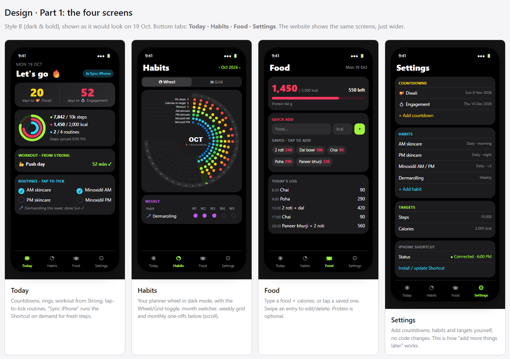
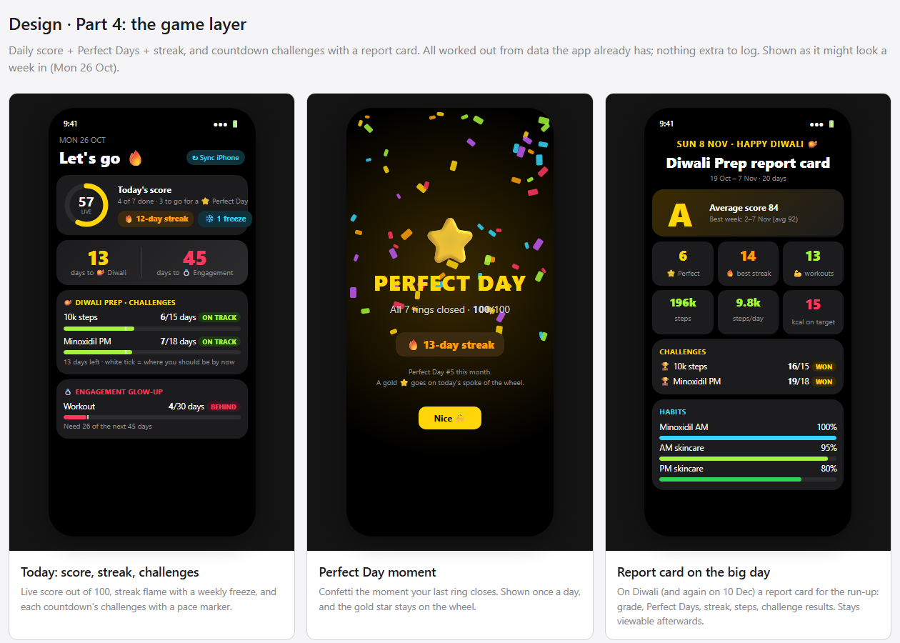
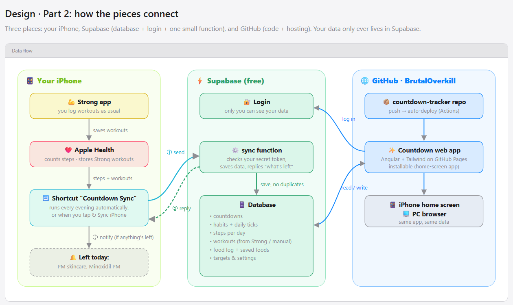

# Countdown — personal tracker: design spec

- **Date:** 2026-10-19
- **Status:** Draft, awaiting Anvit's review
- **Repo:** `BrutalOverkill/countdown-tracker` (public)

## 1. Purpose

A personal tracker for Anvit, used on the iPhone (installed to the home screen) and in a PC browser. It counts down to two dates that matter this season and tracks the daily habits leading up to them: steps, calories, workouts, skincare and hair care. More countdowns and habits will be added over time from inside the app, with no code changes.

**What success looks like**
- Opening the app shows, at a glance: days to each countdown, today's steps / calories / routines, and today's workout.
- Steps and workouts arrive without typing anything.
- A month of habits reads like the paper planner's habit wheel.
- Adding a new countdown or habit takes under a minute in Settings.

## 2. Decisions

| Topic | Decision | Source |
|---|---|---|
| Users | Just Anvit (single user) | said |
| Countdowns | Diwali **8 Nov 2026**, Engagement **10 Dec 2026**; more can be added | said |
| Platform | One web app (PWA): website on PC + installable on iPhone home screen | chose (Q1) |
| Steps | iPhone **Shortcut** reads Apple Health and sends to the backend | chose (Q1) |
| Calories | Quick entry (name + kcal, optional protein) + saved foods for one-tap re-add | chose (Q2) |
| Workouts | From the **Strong** app via Apple Health, session level only (trained? which, how long); fallback one-tap "trained ✓" | chose (Q4) |
| Skincare / hair | Habits: AM skincare, PM skincare, Minoxidil AM, Minoxidil PM (daily); Dermarolling (weekly) | said |
| Reminders | One evening nudge from the Shortcut listing what's left today | chose (Q5) |
| Visual style | **Style B — dark & bold** (black background, Apple-Watch-style rings, big numbers) | chose (mockups) |
| Habit view | Planner-style **wheel** + **grid**, with a toggle | chose (mockups) |
| Stack | Angular + Tailwind, Supabase (DB + login + one function), GitHub Pages | chose (Q6) |
| Repo | Public, personal GitHub account `BrutalOverkill`, app name **Countdown** | chose (Q7) |
| Game layer | Daily score + Perfect Days + streak with a weekly freeze; countdown challenges + report card | chose (Q8, mockups) |
| Food Guard | Once today's calories reach the target, opening a food app (or the App Store) sends you straight back to the home screen — hard close, no "open anyway" | chose (Q9) |
| Timezone | All "days" are India time (`Asia/Kolkata`) | assumed, confirmed |
| Calories "on target" | At least one food logged that day **and** total ≤ target | assumed, confirmed |

## 3. Scope

**In v1:** the four screens below, the game layer (§4.6), the sync function, the iPhone Shortcut (with written setup steps), the Food Guard (§9.1), login, auto-deploy, installable PWA.

**Not in v1** (can be added later): food database search, set/rep detail from Strong, per-routine timed push notifications, offline editing, charts beyond wheel/grid/streaks, multiple users, XP/levels/self-set rewards, badges.

## 4. Screens



Bottom tab bar on the phone: **Today · Habits · Food · Settings**. On screens ≥ 1024 px wide the tabs become a left sidebar and Today's cards flow into two columns; the content is otherwise identical.

Theme tokens (dark only): background `#000`, card `#1C1C1E`, raised `#2C2C2E`, text `#FFF`, muted `#8E8E93`; accents — steps lime `#A3F53B`, calories pink `#FF375F`, routines cyan `#32D7FA`, countdown yellow `#FFD60A`, weekly purple `#BF5AF2`.

### 4.1 Today
- Header: date (e.g. `MON 19 OCT`) and a **↻ Sync iPhone** button. The button opens `shortcuts://run-shortcut?name=Countdown%20Sync`; it is shown only on iOS.
- **Score card** (first card): a ring showing today's score out of 100, labelled `LIVE`. Beside it:
  - "N of M done · K to go for a ⭐ Perfect Day" — or "⭐ Perfect Day!" once it's 100
  - a 🔥 streak chip ("12-day streak")
  - a ❄️ chip when this week's freeze is still unused

  Rules: §8.1.
- **Countdown card:** one tile per upcoming countdown, sorted by date: big number of days + emoji + title.
  - Days = `target_date − today` (IST calendar days).
  - On the day itself the tile reads **"Today! {emoji}"** (e.g. "Today! 🪔 Diwali"), with a **"See your report card →"** button (§4.6).
  - Once the date has passed it disappears from Today (still listed under "Past" in Settings).
- **Challenge cards:** one card per upcoming countdown that has challenges, titled "{emoji} {title}". Each challenge row shows:
  - the habit name and "done / target days"
  - a status chip: ON TRACK (lime), BEHIND (pink), WON 🏆 (yellow) or OUT OF REACH (grey)
  - a progress bar with a white pace marker at `target × elapsed ÷ window`

  The card's footer reads "N days left", or "Need X of the next N days" when a row is BEHIND. Rules: §8.2.
- **Rings card:** three concentric rings with figures beside them.
  - Steps: today's count / step goal. Below: "Steps synced {time}". This label turns amber if the last sync was more than 24 h ago.
  - Calories: today's total / calorie goal.
  - Routines: manual daily habits ticked today / manual daily habits total.
- **Workout card:** today's workout(s) from Strong ("Push day · 52 min ✓" — name as provided by Health, e.g. "Strength Training", if Strong's name isn't available). If none: a **"Trained today ✓"** button that records a manual workout. A manual workout can be removed by tapping it (Health-synced ones can't).
- **Routines card:** manual daily habits grouped by slot (morning / night / anytime), each a tap-to-tick circle; tapping again un-ticks. Below: weekly habits with this week's status ("Dermarolling this week: done Sun ✓" or a tick button).
- Tapping the rings card's calories line opens Food.

### 4.2 Habits
- Header: month switcher `‹ Oct 2026 ›` (back to the first month with data, forward to the current month) and a **Wheel | Grid** toggle. The last choice is remembered on the device.
- **Wheel:** a 270° spiral from 12 o'clock clockwise. One ring per daily habit (outermost = first in sort order), one spoke per day of the month, day numbers in an outer band, and habit names on lines in the empty quadrant (as in the paper planner). A filled dot means done. Today's spoke is highlighted. Auto habits are marked ⚡. A **gold ⭐** sits in the day band on every past Perfect Day.
- **Grid:** rows = daily habits, columns = days 1–31; same dots and highlight. Tapping a dot for a **manual** habit on a past day or today toggles it (to fix a forgotten tick); future days and auto habits aren't tappable. The day header shows ⭐ over past Perfect Days and ❄️ over days saved by a streak freeze. Below the grid: per-habit "done X / elapsed days · best streak N".
- **Weekly** card: rows = weekly habits, columns W1–W5, filled if done in that week.
- **Monthly one-offs** card: a checklist of tasks for the shown month, with "+ add", tick, and swipe-to-delete.
- Habits shown for a month: those created on or before the month's last day and not archived before its first day.

### 4.3 Food
- Summary: today's kcal / goal, "N left" (or "N over" in pink), progress bar, protein total if any protein was logged.
- **Quick add:** food name, kcal, optional protein (g), and a ☆ "save to favourites" toggle. Typing in the name field suggests matching saved foods.
- **Saved foods:** chips sorted by how often they're used; tapping one adds it now. Long-press (or right-click on PC) edits or deletes the saved food.
- **Today's log:** time + name + kcal, newest at the bottom. Swipe (or the ⋯ button on PC) to edit or delete. A day switcher at the top allows viewing/correcting previous days; an entry added to a past day gets `eaten_at` = that day at 12:00 IST.

### 4.4 Settings
- **Countdowns:** list (upcoming, then "Past"), add / edit (title, emoji, date) / delete.
  - The edit sheet holds the countdown's **challenges** (up to 3): pick a daily habit and a target "on X of the N days left". X defaults to `ceil(0.75 × N)` and can be 1–N. Challenges can be deleted, not edited (so a target can't be lowered after a bad week).
  - Tapping a **past** countdown opens its report card.
- **Habits:** list in sort order, drag to reorder; add / edit:
  - name, emoji, colour (defaults to the next rainbow colour)
  - frequency: daily / weekly
  - slot: morning / night / anytime
  - for weekly habits, a preferred weekday (used for the nudge)

  Archive replaces delete, so history stays. The three auto habits (10k steps, Calories on target, Workout) can be reordered and archived, but not edited.
- **Targets:** step goal (default 10,000), calorie goal (default 2,000).
- **iPhone Shortcut:**
  - status: "Connected · last sync {time}" or "Never synced"
  - **Generate / rotate token** (shown once, with a copy button)
  - link to the setup steps
- **Account:** signed-in email, Sign out.

### 4.6 Game layer: Perfect Day moment and report card



- **Perfect Day moment:** when today's score reaches 100 while the app is open (usually right after the last tick), a full-screen overlay appears. It has confetti, "⭐ PERFECT DAY", "All M rings closed · 100/100", the 🔥 streak, "Perfect Day #N this month" and a **Nice 🙌** button that closes it. It shows **at most once per day** — the date it was shown is kept in `localStorage` on that device.
- **Report card** (route `/report/:countdownId`), opened from the countdown tile on the day or from Settings → Past. Period = from the countdown's `created_at` date (IST) to the day before `target_date`. Contents:
  - header "{date} · {title} {emoji}", "{title} report card", period and length in days
  - the grade letter (§8.3), "Average score N" and "Best week: {range} (avg N)" — best = the highest-average run of 7 consecutive days inside the period (skipped if the period is shorter than 7 days)
  - a 3 × 2 stat grid:
    - ⭐ Perfect Days
    - 🔥 best streak
    - 💪 workout days
    - total steps (`196k` style)
    - average steps per day
    - days on calorie target
  - the challenges with final results (WON 🏆 / missed)
  - per-habit completion % bars for the manual daily habits
  - If the period has no days yet (countdown created on its own date), the card shows "Nothing to report — this countdown started today".

### 4.7 Login
Email + password screen, shown when there's no session. **New sign-ups are disabled** in Supabase after Anvit's account is created. (Magic links aren't used: on iOS they open in Safari, not in the home-screen app, so the login wouldn't carry over.)

## 5. Architecture



| Part | What it is |
|---|---|
| **Web app** | Angular (current stable, standalone components + signals, zoneless — same setup as the Kumkum site), Tailwind CSS 4, `@angular/service-worker` for installability and caching the app shell. `supabase-js` v2 for login and data. Served from GitHub Pages at `https://brutaloverkill.github.io/countdown-tracker/`. |
| **Supabase** | Free tier, region Mumbai (`ap-south-1`). Postgres + Auth + two Edge Functions: `sync` (§7) and `food-guard` (§7.1). |
| **iPhone Shortcut** | "Countdown Sync" — reads Apple Health, POSTs to `sync`, shows a notification from the reply. Run by a daily personal automation (default 9:30 PM, "Run Immediately") and by the ↻ Sync iPhone button. |
| **GitHub** | Repo + GitHub Actions: on push to `main`, run tests, build, and deploy to Pages. SPA routing via a copied `404.html`. |

PWA details: manifest `name`/`short_name` "Countdown", `display: standalone`, `theme_color`/`background_color` `#000000`, 180 px `apple-touch-icon`, `apple-mobile-web-app-status-bar-style: black-translucent`.

## 6. Data model (Supabase Postgres)

Every table has `user_id uuid not null default auth.uid() references auth.users`, and an RLS policy allowing all operations only where `user_id = auth.uid()`. All `day` columns are IST calendar dates written by the client or the sync function.

| Table | Columns | Keys / notes |
|---|---|---|
| `settings` | `step_goal int default 10000`, `kcal_goal int default 2000`, `sync_token_hash text null`, `last_sync_at timestamptz null` | PK `user_id` |
| `countdowns` | `id uuid`, `title text`, `emoji text`, `target_date date`, `created_at` | |
| `habits` | `id uuid`, `name text`, `emoji text`, `color text`, `frequency text check in ('daily','weekly')`, `source text check in ('manual','steps','calories','workout')`, `slot text check in ('morning','night','anytime')`, `weekday smallint null` (0 = Sun, weekly only), `sort_order int`, `archived_at timestamptz null`, `created_at` | Seeded: 10k steps, Calories on target, Workout (auto); AM skincare, PM skincare, Minoxidil AM, Minoxidil PM (daily manual); Dermarolling (weekly manual, preferred day Sunday — editable) |
| `habit_checks` | `id uuid`, `habit_id uuid → habits`, `day date`, `created_at` | unique (`habit_id`, `day`); only for `source = 'manual'` |
| `tasks` | `id uuid`, `title text`, `month date` (first of month), `done_at timestamptz null`, `created_at` | monthly one-offs |
| `challenges` | `id uuid`, `countdown_id uuid → countdowns on delete cascade`, `habit_id uuid → habits`, `target_days int check > 0`, `start_day date`, `created_at` | max 3 per countdown (enforced in the app); window = `start_day` … `target_date − 1` |
| `steps_daily` | `day date`, `count int check 0..100000`, `synced_at timestamptz` | PK (`user_id`, `day`) |
| `workouts` | `id uuid`, `started_at timestamptz`, `day date`, `duration_min int null`, `name text null`, `source text check in ('health','manual')` | unique (`user_id`, `started_at`) |
| `saved_foods` | `id uuid`, `name text`, `kcal int`, `protein_g numeric null`, `use_count int default 0` | |
| `food_entries` | `id uuid`, `eaten_at timestamptz`, `day date`, `name text`, `kcal int check 0..10000`, `protein_g numeric null`, `saved_food_id uuid null` | |

`rotate_sync_token()` — a `security definer` Postgres function callable by the signed-in user. It generates 32 random bytes and stores their SHA-256 hash in `settings.sync_token_hash`. It returns the plain token once; the plain token is never stored.

## 7. Sync function contract

`POST https://<project>.supabase.co/functions/v1/sync` — deployed with JWT verification **off**; authenticates by token instead.

Request headers: `Authorization: Bearer <sync token>`, `Content-Type: application/json`.

```json
{
  "today": "2026-10-19",
  "steps": [ { "date": "2026-10-13", "count": 9120 }, { "date": "2026-10-19", "count": 7842 } ],
  "workouts": [ { "start": "2026-10-19T18:02:00+05:30", "durationMin": 52, "name": "Traditional Strength Training" } ]
}
```

Behaviour:
1. Hash the token; find the `settings` row with that hash. Not found → `401 {"error":"Token not recognised — copy it again from Settings"}`.
2. Validate:
   - `today` and `steps[].date` are `YYYY-MM-DD` dates, not in the future, and within the last 31 days
   - counts are 0–100,000
   - at most 31 step rows and 20 workouts

   Any failure → `400 {"error":"<what was wrong>"}`; nothing is saved.
3. Upsert steps by (`user_id`, `day`) — the newer count wins. Upsert workouts by (`user_id`, `started_at`), with `day` = IST date of `start`.
4. Set `settings.last_sync_at = now()`.
5. Work out what's pending for `today`:
   - manual daily habits not ticked today
   - weekly habits whose `weekday` is today's weekday and that aren't done in the current week (§8)
6. Reply `200`:

```json
{ "saved": { "steps": 7, "workouts": 1 }, "pending": ["PM skincare", "Minoxidil PM"], "message": "Left today: PM skincare, Minoxidil PM" }
```

`message` is `""` when nothing is pending. Any unexpected error → `500 {"error":"Server error — try again later"}`. Every failure reply has an `error` key, so the Shortcut can check for it.

### 7.1 Food Guard function

`POST https://<project>.supabase.co/functions/v1/food-guard` — JWT verification off. It uses the same `Authorization: Bearer <sync token>` and the same token check and 401 reply as `sync`. The body is ignored (the Shortcut sends `{}`). It does **not** touch `last_sync_at`.

- Today = current IST date (server side). `kcal` = sum of today's `food_entries.kcal`; `goal` = `settings.kcal_goal`.
- `reached` = `kcal ≥ goal` (so exactly on target counts as reached).
- Reply `200`:

```json
{ "kcal": 2050, "goal": 2000, "reached": true, "message": "🛑 2,050 kcal today — target hit. Kitchen's closed." }
```

  When not reached: `"reached": false`, `"message": ""`. Errors use the same `error` shapes as `sync`.

## 8. Rules (derived, not stored)

- **Today** = current date in `Asia/Kolkata`.
- **Steps habit done** on a day ⇔ `steps_daily.count ≥ settings.step_goal`.
- **Calories habit done** on a day ⇔ ≥ 1 food entry that day **and** total kcal ≤ `kcal_goal`. Today's dot stays empty until the day is over (it can't be judged mid-day); the Today screen shows progress instead.
- **Workout habit done** on a day ⇔ any `workouts` row with that `day`.
- **Manual habit done** on a day ⇔ a `habit_checks` row for that habit and day.
- Goal changes re-score all past days (accepted trade-off of not storing results).
- **Weeks (W1–W5)** are planner-style blocks of the month: W1 = days 1–7, W2 = 8–14, W3 = 15–21, W4 = 22–28, W5 = 29–end. A weekly habit is done in a week if it has any check on a day in that block. "This week" on Today and in the sync nudge uses the same blocks.
- **Habit streak** (grid stats) = consecutive done days of one habit ending today (if done) or yesterday. **Best streak** = longest run within the shown month. No freezes here.

### 8.1 Daily score, Perfect Day, streak

- **Daily habits of a day** = habits with `frequency = 'daily'` that are active that day (created on/before it, not archived on/before it). Weekly habits are not part of the score.
- **Done for scoring** = the done rules above, with one exception. For **today only**, the calories habit counts as done while *on track*: at least one entry and total ≤ goal.
- **Score** = `round(100 × done ÷ count)`; 0 if `count = 0`.
- **Perfect Day** = score 100. A past day's ⭐ uses the final rules, so a day that looked perfect at 8 PM but went over on calories doesn't keep its star.
- **Good day** = score ≥ 80.
- **Overall streak** (🔥 on Today), counted backwards from yesterday:
  - each good day adds 1
  - a day that isn't good is **frozen** (❄️) if no other day in the same Monday–Sunday week has been frozen. It neither adds to nor breaks the streak.
  - any other day that isn't good ends the count
  - days before the first-ever habit day end the count too

  Today then adds 1 if it is already a good day. Freezes are worked out on the fly every time, oldest day first within each week; nothing is stored.
- **Freeze available** (❄️ chip on Today) = no day of the current Monday–Sunday week has been frozen.

### 8.2 Challenges

For a challenge with window `start_day … end_day` (`end_day = target_date − 1`), `window = end_day − start_day + 1`:

- `done` = days in the window (up to today) where the challenge's habit is done (final rules; today counts with the live rule).
- `elapsed` = days from `start_day` through yesterday, clamped to 0…window.
- `left` = days from today through `end_day`, clamped to 0…window.
- Status, checked in this order:
  1. **WON** if `done ≥ target_days`. Missed days never subtract, so it stays won (only un-ticking a past day could undo it).
  2. **OUT OF REACH** if `done + left < target_days`.
  3. **ON TRACK** if `done ≥ target_days × elapsed ÷ window`.
  4. Otherwise **BEHIND**.
- The pace marker sits at `elapsed ÷ window` of the bar. "Need X of the next N days": `X = target_days − done`, `N = left`.
- After `end_day`, a challenge that isn't WON is **missed** (shown only on the report card).

### 8.3 Report card

- **Average score** = mean of the daily scores over the period (final rules); rounded.
- **Grade:** A+ ≥ 90, A ≥ 80, B ≥ 70, C ≥ 60, D < 60.
- **Best streak** = longest run of good days within the period, freezes applied as in §8.1.
- **Workout days** = days in the period with a workout. **Calorie target days** = days the calories habit was done.
- **Habit %** = done days ÷ active days in the period, per manual daily habit.

## 9. iPhone Shortcut

**Before building (first implementation step, ~2 minutes on the phone):**
1. In Strong: confirm workouts are being saved to Apple Health (Strong settings → Apple Health).
2. In Shortcuts: add **Find Health Samples** and check:
   - whether **Workouts** appears as a type, and whether Strong's workouts are listed
   - that Steps supports **Group By: Day**, and that its daily totals match the Health app

If Workouts can't be read, the Shortcut sends steps only, and the workout card relies on "Trained today ✓". The rest of the design is unchanged.

**Shortcut outline** (exact step-by-step instructions are written during implementation, in `docs/iphone-shortcut.md` and linked from Settings):
1. Text: the sync token (pasted from Settings).
2. Find Health Samples — Steps, last 7 days, grouped by day → for each: build `{date (yyyy-MM-dd), count}` and add to a list.
3. Find Health Samples — Workouts, last 2 days → for each: build `{start (ISO 8601), durationMin, name}` and add to a list.
4. Get Contents of URL — POST the JSON from §7 with the `Authorization` header.
5. If the reply has `error` → Show Notification "Countdown sync failed: {error}". Otherwise, if `message` isn't empty → Show Notification `{message}`.

**Automation:** Shortcuts → Automation → Time of Day 9:30 PM daily → Run Immediately → run "Countdown Sync".

### 9.1 Food Guard (hard close)

A web app can't block other apps on iOS; only Screen Time can, and Shortcuts can't toggle Screen Time. The guard uses an **App-opened automation** instead. It adds friction, not a lock: it can be switched off in Shortcuts, and it doesn't cover ordering in Safari.

**Shortcut "Food Guard":**
1. Text: the sync token (the same one).
2. Get Contents of URL — POST `{}` to `food-guard` with the `Authorization` header.
3. Get Dictionary Value `reached`. If it is true:
   - **Go to Home Screen**
   - **Show Notification** `{message}`

   Otherwise, do nothing.
4. If the request fails or the reply has an `error` key, do nothing, so the app opens normally. It fails open: a server problem never locks you out.

**Automation:** Shortcuts → Automation → **App** → "Is Opened" → choose the food apps, e.g. Swiggy, Zomato, Zepto, Blinkit, Domino's and McDonald's, plus the **App Store** (so food apps can't be reinstalled once you're at target) → Run Immediately → run "Food Guard". Turn "Notify When Run" off.

Depends on food being logged in the app: with nothing logged, `kcal` is 0 and nothing is blocked.

## 10. Errors and edge cases

| Situation | Behaviour |
|---|---|
| Sync fails (offline, server down, bad token) | Shortcut shows "Countdown sync failed: …"; app shows amber "Steps synced …" after 24 h |
| Missed evening sync | The next sync re-sends the last 7 days; upserts fill the gap |
| Same workout synced twice | Unique `started_at` → no duplicate |
| App opened offline | App shell loads from cache, showing last-loaded data; banner "Offline — changes won't save"; tick/add controls disabled |
| Session expired | Silent token refresh by `supabase-js`; if that fails → login screen |
| Invalid input in app | Inline message; nothing saved (same limits as DB checks) |
| Habit removed | Archived, history kept; disappears from Today and from months after archiving |
| Countdown date passed | Hidden from Today, listed under "Past" in Settings |
| Supabase free project paused (after 7 days with no activity) | Prevented by the daily sync; if it happens, "Restore" in the Supabase dashboard (documented in README) |
| Sync token leaked / phone lost | Rotate token in Settings; the old one stops working immediately |
| Food Guard can't reach the server (offline, error) | Does nothing; the food app opens normally (fails open) |
| Token rotated but Food Guard still has the old one | 401 → Food Guard does nothing; Settings' setup steps remind you to paste the new token into **both** shortcuts |

## 11. Security

- Public repo contains only code. The Supabase URL and **anon key** in the web app are designed to be public; RLS restricts every row to its owner.
- The **service-role key** exists only as an Edge Function secret and in local `.env` files that are git-ignored — never committed.
- Sign-ups disabled after the owner account exists.
- Sync token stored only as a SHA-256 hash; compared server-side.

## 12. Testing

- **Unit tests** (Angular's default test runner):
  - countdown day maths, including just before and after midnight IST
  - auto-habit scoring
  - daily score, Perfect Day (including the today-only calories rule)
  - overall streak with freezes (two misses in one week, a miss on Sunday then Monday, no history)
  - challenge status (each of the four, WON locking, window edges)
  - report card numbers and grade boundaries
  - habit streaks
  - week blocks
  - month habit visibility
  - calorie totals
- **Sync function tests:**
  - token check (good / bad / missing)
  - validation rejects (future date, out-of-range count, malformed JSON)
  - steps upsert overwrites
  - workout de-duplication
  - pending/message builder
  - Food Guard result: below / exactly at / above the goal, and no entries
- **RLS check:** a script signs in as a second test user and confirms it can read and write none of the owner's rows.
- **Browser check:** every screen exercised in a real browser on the PC (phone-sized and desktop-sized) before calling it done.
- **On-device check (Anvit):** install to home screen, build the Shortcut, run it once, confirm steps/workout appear and the nudge shows.

## 13. Setup steps that need Anvit

1. Create a free Supabase account and a project ("countdown", region Mumbai). Share the project URL, and run `npx supabase login` once so the CLI can deploy.
2. After first deploy: create the owner login (email + password), then sign-ups get switched off.
3. On the iPhone: open the site in Safari → Share → Add to Home Screen; build the Shortcut and the 9:30 PM automation from the written steps; build the Food Guard shortcut and its App-opened automation.

## 14. Risks to verify early

- **Shortcuts reading Strong workouts** from Health — unconfirmed online; checked on the phone first (§9), with a defined fallback.
- **Grouped daily step totals** in Shortcuts matching the Health app (iPhone + Watch de-duplication) — checked at the same time.
- **iOS home-screen app storage:** home-screen web apps keep their own storage; if iOS ever clears it, the only effect is having to log in again (no data lives on the phone).
