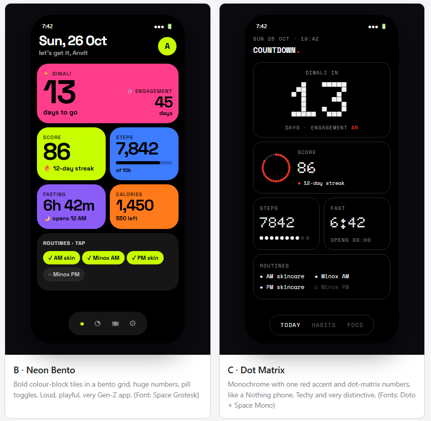

# Countdown — personal tracker: design spec

- **Date:** 2026-10-19
- **Status:** Approved and built (19 Oct 2026). **Amendment A (20 Oct 2026):** "every N days" habits, Dermarolling every 4 days with a due-today highlight (§8.5); supplements as an ordinary daily habit.
- **Repo:** `BrutalOverkill/countdown-tracker` (public)

## 1. Purpose

A personal tracker for Anvit, used on the iPhone (installed to the home screen) and in a PC browser. It counts down to two dates that matter this season and tracks the daily habits leading up to them: steps, calories, workouts, skincare and hair care. More countdowns and habits will be added over time from inside the app, with no code changes.

**What success looks like**
- Opening the app shows, at a glance: days to each countdown, today's steps / calories / routines, and today's workout.
- Steps and workouts arrive without typing anything.
- A month of habits reads like the paper planner's habit wheel.
- Adding a new countdown or habit takes under a minute in Settings.

## 2. Decisions

| Topic | Decision | Source |
|---|---|---|
| Users | Just Anvit (single user) | said |
| Countdowns | Diwali **8 Nov 2026**, Engagement **10 Dec 2026**; more can be added | said |
| Platform | One web app (PWA): website on PC + installable on iPhone home screen | chose (Q1) |
| Steps | iPhone **Shortcut** reads Apple Health and sends to the backend | chose (Q1) |
| Calories | Quick entry (name + kcal, optional protein) + saved foods for one-tap re-add | chose (Q2) |
| Workouts | From the **Strong** app via Apple Health, session level only (trained? which, how long); fallback one-tap "trained ✓" | chose (Q4) |
| Skincare / hair | Habits: AM skincare, PM skincare, Minoxidil AM, Minoxidil PM (daily); Dermarolling (every 4 days after the last session — Amendment A); Supplements is a daily habit Anvit adds in Settings | said |
| Reminders | One evening nudge from the Shortcut listing what's left today | chose (Q5) |
| Visual style | Two dark themes, **Bento** (colour-block tiles) and **Matrix** (dot-matrix, red accent). Theme is **Auto** by time of day: Bento 6 AM–7 PM, Matrix 7 PM–6 AM. A ◐ toggle overrides until the next switch-over. Replaces the earlier "style B dark & bold" | chose (Q15–Q17, mockups) |
| Habit view | Planner-style **wheel** + **grid**, with a toggle | chose (mockups) |
| Stack | Angular + Tailwind, Supabase (DB + login + one function), GitHub Pages | chose (Q6) |
| Repo | Public, personal GitHub account `BrutalOverkill`, app name **Countdown** | chose (Q7) |
| Game layer | Daily score + Perfect Days + streak with a weekly freeze; countdown challenges + report card | chose (Q8, mockups) |
| Food Guard | Once today's calories reach the target, **or outside the eating windows**, opening a food app (or the App Store) sends you straight back to the home screen — hard close, no "open anyway". Apps are picked one by one (Shortcuts can't target the App Store "Food & Drink" category). | chose (Q9, Q10) |
| Intermittent fasting | Eating windows **12:00–1:00 AM** and **11:00 AM–1:00 PM** (editable, up to 3). They are both the eating windows and the only times food apps open. | said (Q10, Q12) |
| Day boundary | The app's day runs **4:00 AM → 3:59 AM IST**, so late-night meals and routines count as the previous day (late work hours) | chose (Q11) |
| Timezone | All "days" are India time (`Asia/Kolkata`) | assumed, confirmed |
| Calories "on target" | At least one food logged that day **and** total ≤ target | assumed, confirmed |

## 3. Scope

**In v1:** the four screens below, the game layer (§4.6), intermittent fasting (§4.1 fasting card, §4.3, §4.4, §8.4), the sync function, the iPhone Shortcut (with written setup steps), the Food Guard (§9.1), login, auto-deploy, installable PWA.

**Not in v1** (can be added later): food database search, set/rep detail from Strong, per-routine timed push notifications, offline editing, **offline data** (nothing private is stored on the device; opening the app offline shows a "connect to load" screen — chose Q14 after review), charts beyond wheel/grid/streaks, multiple users, XP/levels/self-set rewards, badges.

## 4. Screens


*These screen mockups (and the game-layer one in §4.6) show the earlier single dark style. Their content and behaviour still apply; the look now follows the two themes in §4.0.*

Bottom tab bar on the phone: **Today · Habits · Food · Settings**. On screens ≥ 1024 px wide the tabs become a left sidebar and Today's cards flow into two columns; the content is otherwise identical.

### 4.0 Themes



Two dark themes share every screen and layout; only colours, fonts and shapes change. The theme is set as `data-theme="bento" | "matrix"` on `<html>`, and all styling comes from CSS variables and theme-scoped classes. The fonts are bundled with the app (Fontsource packages), so they work offline and nothing loads from Google.

| | **Bento** | **Matrix** |
|---|---|---|
| Base | black `#000`; neutral tile `#161616`; muted `#8E8E93` | black `#000`; boxes with a 1 px `#2A2A2A` border; muted `#8A8A8A` |
| Tiles | solid colour blocks with black text: pink `#FF3D8B` (countdown), lime `#C8FF00` (score), blue `#3D7BFF` (steps), violet `#8B5CF6` (fasting), orange `#FF7A1A` (calories); radius 22 px | every tile is a bordered black box with off-white `#F2F2F2` text; radius 18 px |
| Accent | lime `#C8FF00` (buttons, active tab, ticked pills) | one red `#FF3B30` (highlights, today, streak, active states) |
| Numbers | Space Grotesk, weight 700, tight tracking | **Doto** dot-matrix, weight 900 |
| Text | Space Grotesk | Space Mono; labels uppercase with wide tracking |
| Rings & bars | solid arcs and rounded bars | rings made of dots, and 10-dot bars |
| Routine ticks | pills, lime when done (`✓`) | `●` done / `○` not done |
| Habit wheel | each habit's own colour | all dots off-white; today and ⭐ Perfect Days in red |
| Tab bar | floating dark pill with icons; lime dot on the active tab | floating bordered pill with uppercase text labels |

**Choosing the theme (Auto):**
- Effective theme = a valid override if there is one, else the preference.
- Preference **Auto** (default): Bento when the IST clock is 06:00–18:59, Matrix from 19:00 to 05:59. Preference **Bento** or **Matrix** always wins.
- **◐ toggle** (Today header): flips the theme on screen. Under Auto it stores an override that expires at the next switch-over (the next 06:00 or 19:00 IST). Under a fixed preference it switches the preference itself.
- Both are remembered **per device** (`localStorage`). The last applied theme is set by a tiny script in `index.html` before the app starts, so the wrong theme never flashes.
- Changing theme crossfades with a View Transition when the browser supports it and Reduce Motion is off.

### 4.0.1 Motion

- Rings and bars fill with a spring when a screen opens; key numbers count up from 0 (about 600 ms).
- Tiles and buttons squish slightly on press (`scale(.97)`); a ticked routine pops.
- Tabs crossfade and slide between screens (View Transitions API, where supported).
- The 🔥 streak flickers gently; the countdown number flips when the day changes; there's confetti on a Perfect Day (the Matrix theme uses red/white dot confetti).
- `prefers-reduced-motion: reduce` (iOS Reduce Motion) switches all of it off: values appear at once, with no transitions.

### 4.1 Today
Layout is a **bento grid**: two columns on the phone, four on wide screens.
- Full width: countdown, routines, challenges.
- Half width: score, steps, fasting, calories, workout.

The cards below are those tiles, with tile tones as in §4.0.
- Header: date (e.g. `MON 19 OCT`), a greeting ("let's get it, Anvit"), a **◐ theme toggle** and, on iOS only, a **↻ Sync iPhone** button. The Sync button opens `shortcuts://run-shortcut?name=Countdown%20Sync`.
- **Score popup:** tapping the Score card opens a sheet, "What's left today · X of Y done": every habit that counts today (§8.1), left first — routines with **Tick**, Workout with **Trained today ✓**, auto habits with their progress (steps `7,842 / 10,000`, calories/fasting "Log food to count it" or their status), interval habits "due today" / "overdue N days" — then the done ones greyed. ✕, a tap outside or Escape closes it.
- **Score card** (first card): a ring showing today's score out of 100, labelled `LIVE`. Beside it:
  - "N of M done · K to go for a ⭐ Perfect Day" — or "⭐ Perfect Day!" once it's 100
  - a 🔥 streak chip ("12-day streak")
  - a ❄️ chip when this week's freeze is still unused

  Rules: §8.1.
- **Countdown card:** one tile per upcoming countdown, sorted by date: big number of days + emoji + title.
  - Days = `target_date − today` (IST calendar days).
  - On the day itself the tile reads **"Today! {emoji}"** (e.g. "Today! 🪔 Diwali"), with a **"See your report card →"** button (§4.6).
  - Once the date has passed it disappears from Today (still listed under "Past" in Settings).
- **Challenge cards:** one card per upcoming countdown that has challenges, titled "{emoji} {title}". Each challenge row shows:
  - the habit name and "done / target days"
  - a status chip: ON TRACK (lime), BEHIND (pink), WON 🏆 (yellow) or OUT OF REACH (grey)
  - a progress bar with a white pace marker at `target × elapsed ÷ window`

  The card's footer reads "N days left", or "Need X of the next N days" when a row is BEHIND. Rules: §8.2.
- **Fasting card** (only when fasting is on), updated every minute:
  - Inside a window: "🍽️ Eating window · closes {end time} · {Xh Ym} left", with a ring showing how much of the window has passed.
  - Otherwise: "🌙 Fasting · {Xh Ym} done · next window {start time} in {Xh Ym}", with a ring showing how much of the current fast has passed. The fast runs from the end of the previous window to the start of the next.
- **Rings card:** three concentric rings with figures beside them.
  - Steps: today's count / step goal. Below: "Steps synced {time}". This label turns amber if the last sync was more than 24 h ago.
  - Calories: today's total / calorie goal.
  - Routines: manual daily habits ticked today / manual daily habits total.
- **Workout card:** today's workout(s) from Strong ("Push day · 52 min ✓" — name as provided by Health, e.g. "Strength Training", if Strong's name isn't available). If none: a **"Trained today ✓"** button that records a manual workout. A manual workout can be removed by tapping it (Health-synced ones can't).
- **Routines card:** manual daily habits grouped by slot (morning / night / anytime), each a tap-to-tick circle; tapping again un-ticks. Below: weekly habits with this week's status (e.g. "done Sun ✓" or a tick button), and one line per interval habit that isn't due: "🪡 Dermarolling · next Sat 24 Oct", or "✓ Dermarolling done · next Sat 24 Oct" on the day it was ticked.
- **Due card (Amendment A):** every interval habit that is **due or overdue** today and not yet ticked gets a full-width card right below the header, coloured so it stands out — "🪡 Dermarolling — due today" with a large **Done ✓** button; when overdue it turns red: "overdue since Sat 24 Oct (2 days)". In Matrix: red border and a "● DUE TODAY" label. Ticking it collapses the card into the routines line above.
- Tapping the rings card's calories line opens Food.

### 4.2 Habits
- Header: month switcher `‹ Oct 2026 ›` (back to the first month with data, forward to the current month) and a **Wheel | Grid** toggle. The last choice is remembered on the device.
- **Wheel:** a 270° spiral from 12 o'clock clockwise. One ring per daily habit (outermost = first in sort order), one spoke per day of the month, day numbers in an outer band, and habit names on lines in the empty quadrant (as in the paper planner). A done day fills its whole cell (the segment between two spokes on that habit's ring), like colouring in the paper planner. Today's spoke is highlighted. Auto habits are marked ⚡. A **gold ⭐** sits in the day band on every past Perfect Day.
- **Grid:** rows = daily habits, columns = days 1–31; same dots and highlight. Tapping a dot for a **manual** habit on a past day or today toggles it (to fix a forgotten tick); future days and auto habits aren't tappable. The day header shows ⭐ over past Perfect Days and ❄️ over days saved by a streak freeze. Below the grid: per-habit "done X / elapsed days · best streak N".
- **Weekly** card: rows = weekly habits, columns W1–W5, filled if done in that week.
- Interval habits (§8.5) get a ring on the wheel and a row in the grid like daily habits; a dot marks a day it was done. Their grid stats read "done X / due days".
- **Monthly one-offs** card: a checklist of tasks for the shown month, with "+ add", tick, and swipe-to-delete.
- Habits shown for a month: those created on or before the month's last day and not archived before its first day.

### 4.3 Food
- Summary: today's kcal / goal, "N left" (or "N over" in pink), progress bar, protein total if any protein was logged.
- **Quick add:** food name, kcal, optional protein (g), a **time** field and a ☆ "save to favourites" toggle.
  - Time defaults to now for today, or 12:00 for past days.
  - A time before 4:00 AM means the early hours *after* that day's midnight.
  - Typing in the name field suggests matching saved foods.
- **Outside-window flag:** when fasting is on, every log entry eaten outside the eating windows shows ⚠️ and the time in pink.
- **Saved foods:** chips sorted by how often they're used; tapping one adds it now. Long-press (or right-click on PC) edits or deletes the saved food.
- **Today's log:** time + name + kcal, newest at the bottom. Swipe (or the ⋯ button on PC) to edit or delete. A day switcher at the top allows viewing/correcting previous days; an entry added to a past day gets `eaten_at` = that day at 12:00 IST.

### 4.4 Settings
- **Countdowns:** list (upcoming, then "Past"), add / edit (title, emoji, date) / delete.
  - The edit sheet holds the countdown's **challenges** (up to 3): pick a daily habit and a target "on X of the N days left". X defaults to `ceil(0.75 × N)` and can be 1–N. Challenges can be deleted, not edited (so a target can't be lowered after a bad week).
  - Tapping a **past** countdown opens its report card.
- **Habits:** list in sort order, drag to reorder; add / edit:
  - name, emoji, colour (defaults to the next rainbow colour)
  - frequency: daily / weekly / every N days (N = 2–30; default 4). Choosing "every N days" sets the first due day to today.
  - slot: morning / night / anytime
  - for weekly habits, a preferred weekday (used for the nudge)

  Archive replaces delete, so history stays. The three auto habits (10k steps, Calories on target, Workout) can be reordered and archived, but not edited.
- **Targets:** step goal (default 10,000), calorie goal (default 2,000).
- **Fasting:**
  - an on/off switch (default on)
  - the eating windows, each a start and end time (defaults 00:00–01:00 and 11:00–13:00); add one (max 3) or remove one
  - validation: each window's start is before its end on the same clock day, and windows don't overlap
  - Turning fasting off archives the ⚡ "Fasting windows kept" habit. Turning it back on creates a new one.
- **iPhone Shortcut:**
  - status: "Connected · last sync {time}" or "Never synced"
  - **Generate / rotate token** (shown once, with a copy button)
  - link to the setup steps
- **Appearance:** Theme — **Auto** (Bento by day, Matrix at night) · **Bento** · **Matrix**. Stored on this device only.
- **Account:** signed-in email, Sign out.

### 4.6 Game layer: Perfect Day moment and report card


- **Perfect Day moment:** when today's score reaches 100 while the app is open (usually right after the last tick), a full-screen overlay appears. It has confetti, "⭐ PERFECT DAY", "All M rings closed · 100/100", the 🔥 streak, "Perfect Day #N this month" and a **Nice 🙌** button that closes it. It shows **at most once per day** — the date it was shown is kept in `localStorage` on that device.
- **Report card** (route `/report/:countdownId`), opened from the countdown tile on the day or from Settings → Past. Period = from the countdown's `created_at` date (IST) to the day before `target_date`. Contents:
  - header "{date} · {title} {emoji}", "{title} report card", period and length in days
  - the grade letter (§8.3), "Average score N" and "Best week: {range} (avg N)" — best = the highest-average run of 7 consecutive days inside the period (skipped if the period is shorter than 7 days)
  - a 3 × 2 stat grid:
    - ⭐ Perfect Days
    - 🔥 best streak
    - 💪 workout days
    - total steps (`196k` style)
    - average steps per day
    - days on calorie target
  - the challenges with final results (WON 🏆 / missed)
  - per-habit completion % bars for the manual daily habits
  - If the period has no days yet (countdown created on its own date), the card shows "Nothing to report — this countdown started today".

### 4.7 Login
Email + password screen, shown when there's no session. **New sign-ups are disabled** in Supabase after Anvit's account is created. (Magic links aren't used: on iOS they open in Safari, not in the home-screen app, so the login wouldn't carry over.)

## 5. Architecture


| Part | What it is |
|---|---|
| **Web app** | Angular (current stable, standalone components + signals, zoneless — same setup as the Kumkum site), Tailwind CSS 4, `@angular/service-worker` for installability and caching the app shell only (no API responses are cached). A new deploy is picked up by itself: the app checks whenever it is opened or brought back and switches to the downloaded version at once — unless a field is being typed in, then on the next return. `supabase-js` v2 for login and data. Served from GitHub Pages at `https://brutaloverkill.github.io/countdown-tracker/`. |
| **Supabase** | Free tier, region Mumbai (`ap-south-1`). Postgres + Auth + two Edge Functions: `sync` (§7) and `food-guard` (§7.1). |
| **iPhone Shortcut** | "Countdown Sync" — reads Apple Health, POSTs to `sync`, shows a notification from the reply. Run by a daily personal automation (default 1:30 AM, "Run Immediately") and by the ↻ Sync iPhone button. Plus a second Shortcut, "Food Guard", run by an App-opened automation (§9.1). |
| **GitHub** | Repo + GitHub Actions: on push to `main`, run tests, build, and deploy to Pages. SPA routing via a copied `404.html`. |

PWA details: manifest `name`/`short_name` "Countdown", `display: standalone`, `theme_color`/`background_color` `#000000`, 180 px `apple-touch-icon`, `apple-mobile-web-app-status-bar-style: black-translucent`.

## 6. Data model (Supabase Postgres)

Every table has `user_id uuid not null default auth.uid() references auth.users`, and an RLS policy allowing all operations only where `user_id = auth.uid()`. All `day` columns are **app days** (§8), written by the client or the functions. The exception is `steps_daily.day`, which follows Apple Health's calendar days.

| Table | Columns | Keys / notes |
|---|---|---|
| `settings` | `step_goal int default 10000`, `kcal_goal int default 2000`, `sync_token_hash text null`, `last_sync_at timestamptz null`, `fasting_enabled boolean default true`, `eating_windows jsonb default '[{"start":"00:00","end":"01:00"},{"start":"11:00","end":"13:00"}]'` (array of `{start,end}` `HH:MM` IST clock times, end exclusive) | PK `user_id` |
| `countdowns` | `id uuid`, `title text`, `emoji text`, `target_date date`, `created_at` | |
| `habits` | `id uuid`, `name text`, `emoji text`, `color text`, `frequency text check in ('daily','weekly','interval')`, `interval_days smallint null` (2–30) and `interval_start date null` (first due day) — both set exactly when `frequency = 'interval'`, `source text check in ('manual','steps','calories','workout','fasting')`, `slot text check in ('morning','night','anytime')`, `weekday smallint null` (0 = Sun, weekly only), `sort_order int`, `archived_at timestamptz null`, `created_at` | Seeded: 10k steps, Calories on target, Workout, Fasting windows kept (auto); AM skincare, PM skincare, Minoxidil AM, Minoxidil PM (daily manual); Dermarolling (manual, every 4 days, first due on the setup day — editable) |
| `habit_checks` | `id uuid`, `habit_id uuid → habits`, `day date`, `created_at` | unique (`habit_id`, `day`); only for `source = 'manual'` |
| `tasks` | `id uuid`, `title text`, `month date` (first of month), `done_at timestamptz null`, `created_at` | monthly one-offs |
| `challenges` | `id uuid`, `countdown_id uuid → countdowns on delete cascade`, `habit_id uuid → habits`, `target_days int check > 0`, `start_day date`, `created_at` | max 3 per countdown (enforced in the app); window = `start_day` … `target_date − 1` |
| `steps_daily` | `day date`, `count int check 0..100000`, `synced_at timestamptz` | PK (`user_id`, `day`) |
| `workouts` | `id uuid`, `started_at timestamptz`, `day date`, `duration_min int null`, `name text null`, `source text check in ('health','manual')` | unique (`user_id`, `started_at`) |
| `saved_foods` | `id uuid`, `name text`, `kcal int`, `protein_g numeric null`, `use_count int default 0` | |
| `food_entries` | `id uuid`, `eaten_at timestamptz`, `day date`, `name text`, `kcal int check 0..10000`, `protein_g numeric null`, `saved_food_id uuid null` | |

`rotate_sync_token()` — a Postgres function that runs as the signed-in user, so RLS applies. It generates 32 random bytes and stores their SHA-256 hash in `settings.sync_token_hash`. It returns the plain token once; the plain token is never stored.

## 7. Sync function contract

`POST https://<project>.supabase.co/functions/v1/sync` — deployed with JWT verification **off**; authenticates by token instead.

Request headers: `Authorization: Bearer <sync token>`, `Content-Type: application/json`.

```json
{
  "steps": [ { "date": "2026-10-13", "count": 9120 }, { "date": "2026-10-19", "count": 7842 } ],
  "workouts": [ { "start": "2026-10-19T18:02:00+05:30", "durationMin": 52, "name": "Traditional Strength Training" } ]
}
```

The server works out "today" itself, as the app day (§8), so the phone never has to.

Behaviour:
1. Hash the token; find the `settings` row with that hash. Not found → `401 {"error":"Token not recognised — copy it again from Settings"}`.
2. Validate:
   - `steps[].date` are `YYYY-MM-DD` dates, not after the IST calendar date 15 minutes from now, and within the 31 days before it
   - counts are 0–100,000 (numeric strings and decimals accepted, rounded)
   - workout `start`s parse as date-times in that same range
   - at most 31 step rows and 20 workouts
   - a missing or `null` list counts as empty, and a single object counts as a one-item list (Shortcuts quirks)
   - duplicate dates or starts in one request: the last one wins

   Any other failure → `400 {"error":"<what was wrong>"}`; nothing is saved.
3. Upsert steps by (`user_id`, `day`) — the newer count wins. Upsert workouts by (`user_id`, `started_at`), with `day` = app day of `start`.
4. Set `settings.last_sync_at = now()`.
5. Work out what's pending for the app's today:
   - manual daily habits not ticked today
   - weekly habits whose `weekday` is today's weekday and that aren't done in the current week (§8)
   - interval habits that are due today (§8.5) and not ticked today
6. Reply `200`:

```json
{ "saved": { "steps": 7, "workouts": 1 }, "pending": ["PM skincare", "Minoxidil PM"], "message": "Left today: PM skincare, Minoxidil PM" }
```

`message` is `""` when nothing is pending. Any unexpected error → `500 {"error":"Server error — try again later"}`. Every failure reply has an `error` key, so the Shortcut can check for it.

### 7.1 Food Guard function

`POST https://<project>.supabase.co/functions/v1/food-guard` — JWT verification off. It uses the same `Authorization: Bearer <sync token>` and the same token check and 401 reply as `sync`. The body is ignored (the Shortcut sends `{}`). It does **not** touch `last_sync_at`.

- Today = the app day (§8), worked out server side. `kcal` = sum of that day's `food_entries.kcal`; `goal` = `settings.kcal_goal`.
- `reached` = `kcal ≥ goal` (so exactly on target counts as reached).
- `fasting` = `fasting_enabled` and the current IST clock time is outside every eating window (§8.4).
- `blocked` = `reached || fasting`.
- `message`:
  - when reached: `"🛑 2,050 kcal today — target hit. Kitchen's closed."`
  - when only fasting: `"🌙 Fasting — next window opens at 11:00 AM."`
  - otherwise `""`
- Reply `200`:

```json
{ "kcal": 2050, "goal": 2000, "reached": true, "fasting": false, "nextWindow": "11:00 AM", "blocked": true, "message": "🛑 2,050 kcal today — target hit. Kitchen's closed." }
```

  `nextWindow` is `null` when fasting is off. Errors use the same `error` shapes as `sync`.

## 8. Rules (derived, not stored)

- **App day** of an instant = the IST calendar date of (instant − 4 hours). The app's day runs from 4:00 AM to 3:59 AM IST, so a 12:30 AM meal or a 1 AM tick belongs to the previous day. **Today** = the app day of now. It rolls over at 4:00 AM IST, and a page left open overnight updates by itself.
  - Food entries, workouts and habit ticks get the app day of their time.
  - Steps keep Apple Health's calendar days (Health groups by midnight).
  - Countdown days count app days, so at 1 AM on the 8th, Diwali still shows "1 day".
- **Steps habit done** on a day ⇔ `steps_daily.count ≥ settings.step_goal`.
- **Calories habit done** on a day ⇔ ≥ 1 food entry that day **and** total kcal ≤ `kcal_goal`. Today's dot stays empty until the day is over (it can't be judged mid-day); the Today screen shows progress instead.
- **Workout habit done** on a day ⇔ any `workouts` row with that `day`.
- **Manual habit done** on a day ⇔ a `habit_checks` row for that habit and day.
- **Fasting habit done** on a day ⇔ ≥ 1 food entry that day **and** every entry's IST clock time is inside an eating window (§8.4). Today's dot stays empty until the day is over, like calories; for the live score it counts while no entry so far is outside a window and there is at least one entry.
- Goal changes re-score all past days (accepted trade-off of not storing results).
- **Weeks (W1–W5)** are planner-style blocks of the month: W1 = days 1–7, W2 = 8–14, W3 = 15–21, W4 = 22–28, W5 = 29–end. A weekly habit is done in a week if it has any check on a day in that block. "This week" on Today and in the sync nudge uses the same blocks.
- **Habit streak** (grid stats) = consecutive done days of one habit ending today (if done) or yesterday. **Best streak** = longest run within the shown month. No freezes here.

### 8.1 Daily score, Perfect Day, streak

- **Habits of a day** = active habits (created on/before it, not archived on/before it) that are either `frequency = 'daily'`, or interval habits **due** that day (§8.5). Weekly habits are not part of the score.
- **Done for scoring** = the done rules above, with one exception. For **today only**, the calories habit counts as done while *on track*: at least one entry and total ≤ goal.
- **Score** = `round(100 × done ÷ count)`; 0 if `count = 0`.
- **Perfect Day** = score 100. A past day's ⭐ uses the final rules, so a day that looked perfect at 8 PM but went over on calories doesn't keep its star.
- **Good day** = score ≥ 80.
- **Overall streak** (🔥 on Today), counted backwards from yesterday:
  - each good day adds 1
  - a day that isn't good is **frozen** (❄️) if no other day in the same Monday–Sunday week has been frozen. It neither adds to nor breaks the streak.
  - any other day that isn't good ends the count
  - days before the first-ever habit day end the count too

  Today then adds 1 if it is already a good day. Freezes are worked out on the fly every time, oldest day first within each week; nothing is stored.
- **Freeze available** (❄️ chip on Today) = no day of the current Monday–Sunday week has been frozen.

### 8.2 Challenges

For a challenge with window `start_day … end_day` (`end_day = target_date − 1`), `window = end_day − start_day + 1`:

- `done` = days in the window (up to today) where the challenge's habit is done (final rules; today counts with the live rule).
- `elapsed` = days from `start_day` through yesterday, clamped to 0…window.
- `left` = days from today through `end_day`, clamped to 0…window.
- Status, checked in this order:
  1. **WON** if `done ≥ target_days`. Missed days never subtract, so it stays won (only un-ticking a past day could undo it).
  2. **OUT OF REACH** if `done + left < target_days`.
  3. **ON TRACK** if `done ≥ target_days × elapsed ÷ window`.
  4. Otherwise **BEHIND**.
- The pace marker sits at `elapsed ÷ window` of the bar. "Need X of the next N days": `X = target_days − done`, `N = left`.
- After `end_day`, a challenge that isn't WON is **missed** (shown only on the report card).

### 8.3 Report card

- **Average score** = mean of the daily scores over the period (final rules); rounded.
- **Grade:** A+ ≥ 90, A ≥ 80, B ≥ 70, C ≥ 60, D < 60.
- **Best streak** = longest run of good days within the period, freezes applied as in §8.1.
- **Workout days** = days in the period with a workout. **Calorie target days** = days the calories habit was done.
- **Habit %** = done days ÷ active days in the period, per manual daily habit; for an interval habit, done-while-due days ÷ due days.

### 8.4 Eating windows

- A window `{start, end}` covers IST clock minutes `start ≤ t < end` (end exclusive). `00:00–01:00` covers 12:00–12:59 AM.
- **Inside a window** = the clock time is inside any window. It's judged on the clock only, never the app day: the 12–1 AM window is the same window every night.
- **Next window start** = the first window start later than now; if none is left today, the earliest start tomorrow. It's shown as `h:mm AM/PM`, e.g. `12:00 AM`, `11:00 AM`.
- **Current fast** (fasting card): from the most recent window end before now to the next window start. With the defaults, that's 1:00 AM → 11:00 AM (10 h) and 1:00 PM → 12:00 AM (11 h).
- **Valid windows:** 1–3 windows; `HH:MM` 24-hour; start < end; no two overlap. Saved sorted by start.

### 8.5 Interval habits — "every N days" (Amendment A)

- An interval habit has `interval_days = N` and `interval_start` = its first due day.
- **Next due on day D** = (latest tick strictly before D) + N; if there's no tick on or after `interval_start` before D, it's `interval_start`.
- **Due on D** = D ≥ next due on D, and the habit is active on D. Being due counts as an open routine in that day's score (§8.1) until it's ticked; overdue days keep counting, so an overdue session blocks a Perfect Day.
- A tick on a day it isn't due is allowed (from the grid) and restarts the cycle from that day, but that day doesn't count it in the score.
- **Shown "next" date** = today + N on the day it's ticked; otherwise next due as above. Overdue days = today − next due.
- **Challenges** stay daily-habits only.
- Dermarolling becomes `interval_days = 4`, `interval_start` = the later of its app creation day and 2026-10-20; new accounts get it with `interval_start` = the setup day.

## 9. iPhone Shortcut

**Before building (first implementation step, ~2 minutes on the phone):**
1. In Strong: confirm workouts are being saved to Apple Health (Strong settings → Apple Health).
2. In Shortcuts: add **Find Health Samples** and check:
   - whether **Workouts** appears as a type, and whether Strong's workouts are listed
   - that Steps supports **Group By: Day**, and that its daily totals match the Health app

If Workouts can't be read, the Shortcut sends steps only, and the workout card relies on "Trained today ✓". The rest of the design is unchanged.

**Shortcut outline** (exact step-by-step instructions are written during implementation, in `docs/iphone-shortcut.md` and linked from Settings). Shortcuts' JSON body can't reliably hold a list of dictionaries, so the Shortcut sends one small request per item. The server accepts a bare object as a one-item list, and an empty body as "nothing to save".
1. Text: the sync token (pasted from Settings).
2. Find Health Samples — Steps, last 7 days, grouped by day → for each: POST `{"steps": {"date": yyyy-MM-dd, "count": n}}`.
3. Find Health Samples — Workouts, last 2 days → for each: POST `{"workouts": {"start": ISO 8601, "durationMin": n, "name": type}}`.
4. After **every** POST in steps 2–3: if the reply has `error` → Show Notification "Countdown sync failed: {error}" and **Stop This Shortcut**, so a failed day never hides behind a later successful nudge.
5. A final POST `{"ping": "1"}` → its reply carries the nudge.
6. If that reply has `error` → Show Notification "Countdown sync failed: {error}". Otherwise, if `message` isn't empty → Show Notification `{message}`.

Partial runs are safe. Earlier requests may already be saved when a later one fails. Re-running the Shortcut re-sends everything, and the upserts converge with no duplicates. Each step POST **replaces** that day's total, because Health gives complete daily aggregates.

**Automation:** Shortcuts → Automation → Time of Day **1:30 AM** daily → Run Immediately → run "Countdown Sync". It runs after the late-night meal and routines; it's still "today" until 4 AM. Any time works, and a second automation, e.g. 9:30 PM, is fine too.

### 9.1 Food Guard (hard close)

A web app can't block other apps on iOS; only Screen Time can, and Shortcuts can't toggle Screen Time. The guard uses an **App-opened automation** instead. It is a **deterrent, not an app lock**:
- it can be switched off in Shortcuts
- newly installed apps aren't covered until ticked
- it doesn't cover ordering in Safari
- it can't decide without the server

A real lock would need a native app using Apple's Screen Time APIs and an Apple-approved entitlement, which is out of scope.

**Shortcut "Food Guard":**
1. Text: the sync token (the same one).
2. Get Contents of URL — POST `{}` to `food-guard` with the `Authorization` header.
3. Get Dictionary Value `error`. If it has any value → **Show Notification** "Food Guard couldn't check: {error}" and leave the app open. This is the **unknown** state: never shown as allowed or blocked.
4. Otherwise get Dictionary Value `message`; it's non-empty exactly when `blocked` is true, and text is simpler to test in Shortcuts. If it has any value:
   - **Go to Home Screen**
   - **Show Notification** `{message}`

   Otherwise (allowed), do nothing.
5. If the request itself fails (no network), Shortcuts shows its own error and the app opens. It fails open: a server problem never locks you out.

**Automation:** Shortcuts → Automation → **App** → "Is Opened" → choose the food apps, e.g. Swiggy, Zomato, Zepto, Blinkit, Domino's and McDonald's, plus the **App Store** (so food apps can't be installed while blocked) → Run Immediately → run "Food Guard". Turn "Notify When Run" off.
- Shortcuts can't select the App Store's "Food & Drink" category, so each app is ticked once, by hand. A newly installed food app needs adding to the automation.
- Screen Time's "Shopping & Food" category limit is an optional extra Anvit can set by hand. It's a fixed daily allowance and doesn't react to calories or windows.

What blocks:
- **outside the eating windows** (when fasting is on): always, logged or not
- **inside a window:** only once logged calories reach the target. With nothing logged, `kcal` is 0, so it doesn't block.

## 10. Errors and edge cases

| Situation | Behaviour |
|---|---|
| Sync fails (offline, server down, bad token) | Shortcut shows "Countdown sync failed: …"; app shows amber "Steps synced …" after 24 h |
| Missed evening sync | The next sync re-sends the last 7 days; upserts fill the gap |
| Same workout synced twice | Unique `started_at` → no duplicate |
| App opened offline | App shell loads from cache. No data is stored on the device, so it shows "You're offline — connect to load your data" with **Retry**. |
| Signal lost while the app is open | Data already loaded stays on screen; banner "Offline — changes won't save"; tick/add controls disabled |
| Data fails to load (server error) | "Couldn't load your data" with **Retry** — never an endless "Loading…" |
| Session expired | Silent token refresh by `supabase-js`; if that fails → all in-memory data is cleared, then the login screen |
| Sign out, or a different account signs in | All in-memory data, pending writes and in-flight loads from the previous session are discarded before anything renders |
| Double-tap on a save button | Buttons are disabled while a save is in flight; a second submit is ignored |
| Invalid input in app | Inline message; nothing saved (same limits as DB checks) |
| Habit removed | Archived, history kept; disappears from Today and from months after archiving |
| Countdown date passed | Hidden from Today, listed under "Past" in Settings |
| Supabase free project paused (after 7 days with no activity) | Prevented by the daily sync; if it happens, "Restore" in the Supabase dashboard (documented in README) |
| Sync token leaked / phone lost | Rotate token in Settings; the old one stops working immediately |
| Food Guard can't reach the server (offline, error) | Does nothing; the food app opens normally (fails open) |
| Token rotated but Food Guard still has the old one | 401 → notification "Food Guard couldn't check: Token not recognised…"; the app stays open. Settings' setup steps remind you to paste the new token into **both** shortcuts |
| New token lost before it was pasted (page closed, copy failed) | Rotate again; the token is never stored anywhere readable, so a fresh one is the recovery |
| Meal at 12:30 AM | Belongs to the previous app day (before 4 AM); inside the 00:00–01:00 window, so no ⚠️ |
| Lunch logged at 9 PM | Time field set to 12:15 → stored at 12:15, inside the window; logging late never flags a meal by itself |
| Eating windows changed | Past days re-score against the new windows (same trade-off as goals) |
| Invalid windows (overlap, start ≥ end, more than 3) | Inline message in Settings; nothing saved |

## 11. Security

- Public repo contains only code. The Supabase URL and **anon key** in the web app are designed to be public; RLS restricts every row to its owner.
- The **service-role key** exists only as an Edge Function secret and in local `.env` files that are git-ignored — never committed.
- Sign-ups disabled after the owner account exists.
- Sync token stored only as a SHA-256 hash; compared server-side.
- The Edge Functions use the service key, so **their** checks are the security boundary:
  - ownership comes only from the verified token; any `user_id` in the payload is ignored
  - every field is validated, and a failed write never returns success
  - errors are logged without payloads or tokens
- No API response is cached on the device (§10).
- Live tests refuse to run unless the configured account's email contains "test", so they can never wipe Anvit's own data.

## 12. Testing

- **Unit tests** (Angular's default test runner):
  - countdown day maths, including just before and after midnight IST
  - the app day: 3:59 AM is still the previous day, 4:00 AM is the new day; the clock rolls at 4 AM
  - eating windows: membership at start/end edges, next window start (later today / tomorrow), current fast length, validation
  - fasting habit: all inside, one outside, no entries, today live vs final
  - fasting card states
  - auto-habit scoring
  - daily score, Perfect Day (including the today-only calories rule)
  - overall streak with freezes (two misses in one week, a miss on Sunday then Monday, no history)
  - challenge status (each of the four, WON locking, window edges)
  - report card numbers and grade boundaries
  - habit streaks
  - week blocks
  - month habit visibility
  - calorie totals
- **Sync function tests:**
  - token check (good / bad / missing)
  - validation rejects (future date, out-of-range count, malformed JSON)
  - steps upsert overwrites
  - workout de-duplication
  - pending/message builder
  - Food Guard result: below / exactly at / above the goal, no entries, fasting hours (blocked even with 0 kcal), fasting off, both reasons at once (target message wins)
- **Invariant tests** over 200 seeded random histories:
  - scores are whole numbers 0–100 and never `NaN`
  - streaks are bounded, and frozen days are never good days
  - archived habits never count after their archive day
  - challenge progress stays inside its window (done can pass the target, e.g. 16/15, but never the window)
  - reports are the same for the same input
  - future records never change past scores

Six layers (chose Q13). The first two run in CI on every push. Layers 3–5 run on demand: locally with `npm run test:live`, or from a manual GitHub workflow. They use a dedicated **test user** whose data is wiped at the start of each run.

1. **Unit tests:** everything listed above and below, written test-first.
2. **Component tests** (Angular TestBed): each screen's components get fed sample view models. They assert on what's rendered and what taps emit. Theme cases:
   - theme logic: Auto at 05:59 / 06:00 / 18:59 / 19:00 IST, an override until the next switch-over, an expired override, fixed preferences, blocked storage
   - rings and bars draw arcs in Bento and dots in Matrix
   - count-up jumps straight to the value under Reduce Motion

   Other cases include:
   - fasting card open vs fasting
   - ⚠️ on an outside-window entry
   - challenge chips
   - Perfect Day overlay shown once per day
   - Settings validation messages
3. **End-to-end browser tests** (Playwright, Chromium, phone-sized and desktop-sized) against the app on a local dev server and the real Supabase project, signed in as the test user. The **app's** clock is pinned through a test-only global (`window.__countdownNow`), so time-based states are deterministic. Supabase auth keeps the real clock, because faking the whole browser clock would make every session token look expired. Covers:
   - login / logout
   - ticking routines → score, rings and wheel update
   - quick-add, saved foods and the time field → totals and ⚠️
   - a countdown + challenge → challenge card
   - fasting card at a pinned "fasting" time and a pinned "window open" time
   - the 4 AM rollover (3:59 AM vs 4:00 AM)
   - the report card on a countdown's date
   - offline banner (`context.setOffline`)
   - a failed data load → "Couldn't load your data" → Retry recovers
   - sign-out discards the session's data (going Back doesn't show it)
   - Settings validation for windows
   - theme: Bento at a pinned 2 PM, Matrix at 8 PM; ◐ flips it and the override survives a reload
4. **Live function tests** (Node script, test user's token):
   - `sync`:
     - 401 for no or wrong token
     - 400 for bad bodies
     - 200 with steps + workouts
     - idempotent re-send
     - a corrected step total replaces the old one
     - a partly invalid batch saves nothing
     - an empty body is accepted
     - Shortcuts quirks (strings, single object, nulls)
     - a `user_id` in the payload is ignored
     - pending/nudge message
   - token rotation: the old token gets 401 at once, the new one works
   - `food-guard`: under target inside a window, at target, outside the windows with 0 kcal, fasting off. Windows are set relative to the real current time, because the server's clock can't be pinned.
5. **Security test** (Node script), **every table**, using otherwise-valid rows (real foreign keys), so a rejection can only be RLS (error `42501`):
   - signed in as the test user, every table returns only the test user's rows
   - inserting a row for any other `user_id` is rejected
   - updating one of your own rows to another `user_id` is rejected
   - signed out (anon key only), every table returns nothing and `ensure_setup` / `rotate_sync_token` are refused
6. **iPhone test checklist** — `docs/test-plan.md`: numbered manual cases with steps and expected results, for what only the phone can show:
   - home-screen install, icon, standalone launch; offline launch shows "connect to load" and Retry works
   - Countdown Sync by tap and by the 1:30 AM automation; the nudge text
   - steps/workout appearing in the app
   - Food Guard outside the windows (e.g. 2 PM), inside a window under target (e.g. 11:30 AM), at target, App Store blocked, server unreachable (airplane mode → app opens), old token (→ "couldn't check" notification)
   - 4 AM rollover on the device
   - Perfect Day overlay on the phone
   - themes on the device: Auto switching at 7 PM / 6 AM, ◐ override, Reduce Motion on → no animations, fonts render offline

Before calling a task done, every screen is also checked by hand in a real browser on the PC (phone-sized and desktop-sized).

## 13. Setup steps that need Anvit

1. Create a free Supabase account and a project ("countdown", region Mumbai). Share the project URL, and run `npx supabase login` once so the CLI can deploy.
2. In the Supabase dashboard: switch sign-ups off, then create two users (email + password, auto-confirmed):
   - Anvit's own login
   - a **test user** for layers 3–5 of §12, whose email **must contain "test"** (e.g. `you+countdown-test@gmail.com`). Its details go in the git-ignored `.env.local` (and, for the manual GitHub workflow, as repository secrets).
3. On the iPhone: open the site in Safari → Share → Add to Home Screen; build the Shortcut and the 1:30 AM automation from the written steps; build the Food Guard shortcut and its App-opened automation (ticking each food app + the App Store).

## 14. Risks to verify early

- **Shortcuts reading Strong workouts** from Health — unconfirmed online; checked on the phone first (§9), with a defined fallback.
- **Grouped daily step totals** in Shortcuts matching the Health app (iPhone + Watch de-duplication) — checked at the same time.
- **iOS home-screen app storage:** home-screen web apps keep their own storage; if iOS ever clears it, the only effect is having to log in again (no data lives on the phone).
